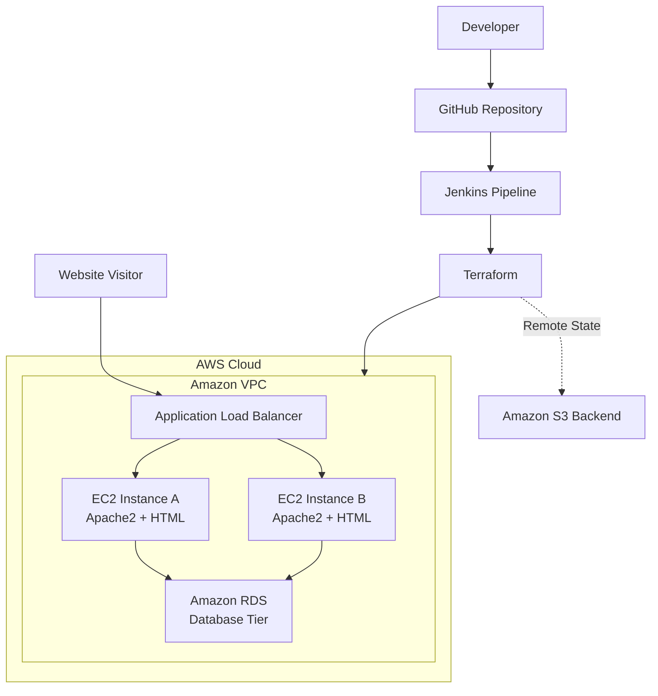
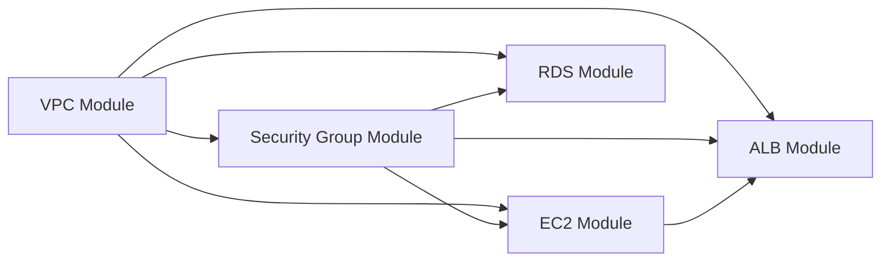
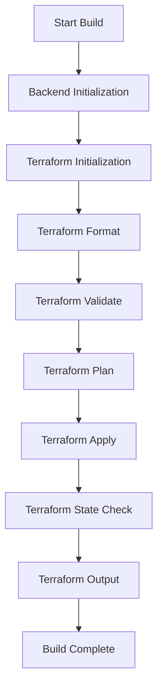

<div align="center">
    
# Three-Tier AWS Web Application

### Terraform • Jenkins • EC2 • Apache2 • ALB • Amazon RDS


A hands-on AWS infrastructure project demonstrating a three-tier web application architecture using Terraform and Jenkins. The project provisions an Application Load Balancer, EC2 instances running Apache2, and an Amazon RDS database. Terraform modules organize the infrastructure, while Jenkins automates the provisioning workflow.

[Repository](https://github.com/Armaan-2005/2-tier-application) · [Architecture](#architecture) · [Project Structure](#project-structure) · [Setup](#run-the-project)

</div>

---

## Contents

- [Project Overview](#project-overview)
- [Architecture](#architecture)
- [AWS Components](#aws-components)
- [Project Structure](#project-structure)
- [Terraform Module Relationships](#terraform-module-relationships)
- [Jenkins Pipeline](#jenkins-pipeline)
- [Prerequisites](#prerequisites)
- [Run the Project](#run-the-project)
- [Security Notes](#security-notes)
- [Cleanup](#cleanup)
- [Learning Outcomes](#learning-outcomes)
- [Future Improvements](#future-improvements)

## Project Overview

This project demonstrates how to deploy a scalable and modular AWS web application infrastructure using Infrastructure as Code (IaC).

The architecture consists of three main components:

1. **Load Balancing Tier:** An Application Load Balancer receives incoming HTTP requests and distributes them across healthy EC2 instances.
2. **Web/Application Tier:** EC2 instances running Apache2 serve the HTML website and can communicate with the database when required.
3. **Database Tier:** Amazon RDS provides managed relational database infrastructure in private subnets.

Terraform provisions and manages the AWS infrastructure using reusable modules. Jenkins automates the Terraform workflow, and Amazon S3 stores the Terraform remote state.

### Project Goals

- Deploy a three-tier AWS application architecture.
- Provision infrastructure using Terraform.
- Organize infrastructure using reusable Terraform modules.
- Host a website using Apache2 on EC2.
- Distribute incoming traffic through an Application Load Balancer.
- Configure Amazon RDS in private subnets.
- Store Terraform state remotely in Amazon S3.
- Automate Terraform operations using Jenkins.

## Architecture



### How the Architecture Works

1. A visitor accesses the website through the ALB DNS address.
2. The ALB receives the HTTP request and forwards it to a healthy EC2 instance.
3. Apache2 on the selected EC2 instance serves the HTML website.
4. The application tier communicates with Amazon RDS when database operations are required.
5. Terraform provisions the infrastructure and manages its state using Amazon S3.
6. Jenkins executes the Terraform pipeline to provision and inspect the infrastructure.

**Note:** The ALB is the traffic entry point. The EC2 instances form the web/application tier, and RDS forms the database tier. Amazon S3 is used for Terraform state storage, not website hosting.

## AWS Components

| Component | Purpose |
|---|---|
| Amazon VPC | Provides network isolation |
| Public Subnets | Host the internet-facing ALB and EC2 instances in this configuration |
| Private Subnets | Provide network placement for RDS |
| Security Groups | Control traffic between infrastructure components |
| Amazon EC2 | Runs Apache2 and serves the website |
| Apache2 | Web server for the HTML application |
| Application Load Balancer | Distributes incoming traffic across EC2 instances |
| Target Group | Registers EC2 instances and monitors their health |
| Amazon RDS | Provides managed relational database infrastructure |
| Amazon S3 | Stores Terraform remote state |
| Terraform | Provisions and manages AWS infrastructure |
| Jenkins | Automates Terraform operations |

## Project Structure

```text
3-tier-application/
├── backend/
│   └── Terraform configuration for S3 remote state
│
├── modules/
│   ├── vpc/
│   │   └── VPC, subnets, routing and key-pair resources
│   ├── sg/
│   │   └── Security groups for EC2 and RDS
│   ├── ec2/
│   │   └── EC2 instances and Apache2/HTML setup
│   ├── alb/
│   │   └── ALB, listener and target group
│   └── rds/
│       └── RDS and database subnet configuration
│
├── main.tf       # Root configuration and module connections
├── output.tf     # ALB DNS URL output
├── Jenkinsfile   # Jenkins pipeline
└── .gitignore    # Files excluded from Git
```

## Terraform Module Relationships



Terraform uses module input and output references to determine dependencies and resource creation order.

### Module Responsibilities

- **VPC:** Creates the VPC, subnets, routing resources and key-pair-related resources.
- **Security Groups:** Defines the permitted traffic between the ALB, EC2 instances and RDS.
- **EC2:** Creates the web instances and configures Apache2 to serve the HTML page.
- **ALB:** Creates the load balancer, listener, target group and target registrations.
- **RDS:** Creates the managed database and its subnet configuration.

The root Terraform configuration connects the modules using their input and output values.

## Jenkins Pipeline

The Jenkinsfile defines a declarative pipeline that automates Terraform operations using Windows `bat` commands and the Jenkins credential entry `AWS_credentials`.



### Pipeline Stages

| Stage | Purpose |
|---|---|
| Backend Initialization | Initializes and applies the Terraform backend configuration |
| Terraform Initialization | Initializes the root configuration |
| Terraform Planning | Formats, validates and creates the Terraform plan |
| Terraform Execution | Applies the saved Terraform plan |
| Terraform State Check | Lists managed resources and displays outputs |

### Pipeline Requirements

- Jenkins agent with Windows `bat` support.
- Terraform installed and available on the agent's PATH.
- AWS credentials configured in Jenkins.
- Jenkins credential entry named `AWS_credentials`.
- Existing S3 backend bucket.
- Git access to the project repository.

The pipeline automates infrastructure provisioning. It does not include a separate application deployment stage for copying updated HTML files to EC2.

## Prerequisites

- AWS account with permissions to create VPC, EC2, ALB, RDS, security groups and S3 resources.
- Terraform CLI.
- Jenkins with AWS credential binding support.
- Git.
- An S3 bucket for Terraform remote state.
- A configured Jenkins AWS credential entry.

## Run the Project

### 1. Clone the Repository

```bash
git clone https://github.com/Armaan-2005/2-tier-application.git
cd 2-tier-application
```

### 2. Configure AWS Credentials

For local testing:

```bash
aws configure
aws sts get-caller-identity
```

For Jenkins, configure the AWS credential entry referenced by the pipeline.

Never hardcode AWS access keys in Terraform files or commit them to Git.

### 3. Provision the Terraform Backend

Navigate to the backend directory:

```bash
cd backend
terraform init
terraform plan
```

If the backend resources do not already exist, review and apply the plan:

```bash
terraform apply
```

Avoid recreating the S3 bucket if it already exists.

### 4. Initialize the Root Configuration

```bash
cd ..
terraform init -reconfigure
terraform fmt
terraform validate
terraform plan
```

Review the plan before applying.

### 5. Provision AWS Infrastructure

```bash
terraform apply
```

Confirm the proposed changes.

AWS resources can incur charges while they are running.

### 6. Access the Website

```bash
terraform output load_balancer_dns
```

Open the returned URL in a browser.

If the website does not load, check:

- ALB listener configuration.
- Target group health.
- Apache2 service status.
- Security group rules.
- EC2 instance initialization logs.

### 7. Run Through Jenkins

Configure a Jenkins job to use this repository and its Jenkinsfile.

Verify that Terraform is installed on the Windows agent and that the `AWS_credentials` entry is available.

Run the pipeline and inspect the console output for each stage.

## Security Notes

- Never commit AWS credentials, private keys or database passwords.
- Enable encryption and versioning for the S3 state bucket.
- Restrict SSH ingress to trusted IP addresses.
- Prefer allowing EC2 HTTP traffic only from the ALB security group.
- Restrict RDS ingress to the intended application tier.
- Keep RDS in private subnets and disable public accessibility unless explicitly required.
- Use least-privilege IAM permissions for Jenkins.
- Review Terraform plans before applying or destroying resources.

## Cleanup

When the environment is no longer needed, review planned deletions before destroying resources.

```bash
terraform plan -destroy
terraform destroy
```

Run these commands from the root Terraform configuration directory.

Manage the backend configuration separately.

**Do not delete the S3 state bucket while any Terraform configuration still depends on it.**

## Learning Outcomes

- Three-tier AWS application architecture.
- Terraform modules and remote state management.
- VPC, subnet and security group configuration.
- EC2 provisioning and Apache2 web hosting.
- ALB listeners, target groups and health checks.
- Amazon RDS placement and private database networking.
- Jenkins declarative pipelines and AWS credentials.
- Infrastructure troubleshooting and Terraform outputs.

## Future Improvements

- Add automated website health checks.
- Add a dedicated application deployment stage.
- Store database credentials in AWS Secrets Manager.
- Configure HTTPS using AWS Certificate Manager.
- Add CloudWatch alarms for EC2 and ALB health.
- Implement EC2 Auto Scaling.
- Add a manual approval stage before production infrastructure changes.
- Deploy the application tier in private subnets and use a controlled outbound access mechanism.

---

## Author

**Mohammed Armaan Bakshi**

- GitHub: [@Armaan-2005](https://github.com/Armaan-2005)

---

Built as a practical AWS, Terraform and Jenkins learning project.
